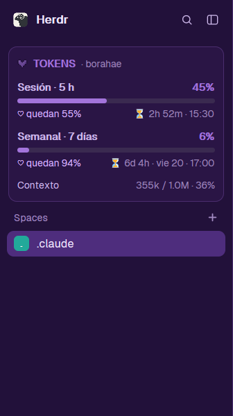

# Borahae 💜

Un layout morado para [herdr](https://herdr.dev) y un equipo de chibis pixel art para Claude Code.



## Qué incluye

- **Layout de herdr** (`layouts/borahae.json`, `themes/borahae.json`, `backgrounds/borahae-hearts.png`):
  - Fondo violeta con corazones pixelados, terminales semitransparentes y barra lateral morada.
  - Una tarjeta **Tokens** arriba de Spaces (`mods/borahae-tokens`) que muestra tu uso del plan de Claude (5 h y semanal) y cuánto falta para que se restablezca.
- **Plugin de Claude Code** (`claude-code/borahae`): siete chibis como agentes con roles intercambiables y un panel animado: escenario arriba y camerino pixel art abajo. Ver [su README](claude-code/borahae/README.md).

## Instalación

**herdr:** pídele a tu agente que agregue este layout desde herdr.dev, o copia `layouts/`, `themes/`, `backgrounds/` y `mods/` a `~/.config/herdr-app/`. Después cambia de layout con `Ctrl+Shift+L`.

**Claude Code:** en una sesión de terminal:

```
/plugin install borahae --marketplace Janis-not/Borahae_
```

La tarjeta de tokens se llena cuando el plugin escribe `~/.claude/borahae-usage.json`, después de la primera respuesta.

## Licencia

MIT.
