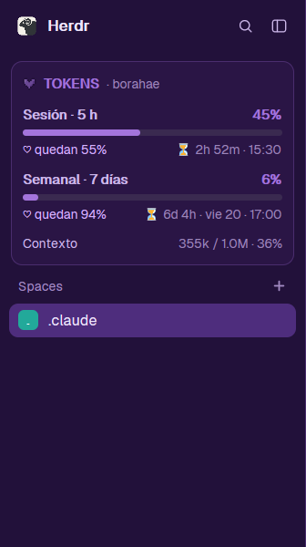

# Borahae

A purple herdr layout: a deep violet window with soft pixel hearts behind half-transparent terminals, a violet sidebar, and a **Tokens** card above Spaces that shows how much of your Claude plan's 5-hour and weekly windows you have used and how long until each resets. It pairs with the **Borahae** Claude Code plugin in `claude-code/borahae` (seven pixel chibis as agents), which writes the figures the card shows.



## What you see

- **Window background:** `backgrounds/borahae-hearts.png`, a 1920×1200 gradient from `#160a28` (top left) through `#2d1448` to `#4a2470` (bottom right), with ~70 small hearts in `#c9a0ff` / `#a374db` / `#e6c8ff` at 7–19% opacity and one large faint heart in the lower right. `fit: cover`.
- **Terminals:** `terminal_opacity` 0.6, so the hearts show through behind the text. Pane cards keep a 10px radius, `#5b3f7a` border, `#a374db` focus border, no card background of their own.
- **Theme** `themes/borahae.json`: background `#1c1030`, foreground `#ece4f7`, cursor `#d6b4fc`, selection `#4a2d6e`, a soft pastel ANSI set (pink `#ff7a9c`, mint `#9fe0b0`, butter `#f5d98b`, sky `#8fb4ff`, violet `#c79bf2`, aqua `#7fdbe0`).
- **Layout colors** (root `colors`): chrome `#22113a`, canvas `#1a0c2c`, surface `#2a1545`, hover `#3d2263`, selected `#4e2d7d`, border `#4a2d6e`, foreground `#efe6fb`, muted `#cdb8ea`, dim `#a48cc4`, accent `#b388f0`, solid `#a374db`; agent states working `#d6b4fc`, done `#9fe0b0`, blocked `#ff9bb5`, idle `#8f7aa8`.
- **Sidebar, top to bottom:** brand (46px), **Tokens card** (190px), Spaces and Agents (shipped `spaces` and `agents` mods), footer (69px).
- **Tokens card** (`mods/borahae-tokens`): a rounded `#2a1545` card with a `#4a2d6e` border. Header: a 13px pixel heart that slowly pulses, "TOKENS" in `#a374db` semibold 12px, "· borahae" in `#9c86b8`. For each plan window (5 h, weekly): its label and the percent used on one row, a 6px bar (`#3a2a50` track; fill `#a374db`, `#ffd166` from 75%, `#ff6b81` from 90%), then "♡ quedan N%" and "⏳ 2h 52m · 15:30" (time to reset and the local reset time; another day shows as "vie 20 · 17:00"). Last row: context window "355k / 1.0M · 36%".

## How it behaves

- Agent statuses use the shipped `agents` mod, recolored by the layout colors above.
- The Tokens card reads `~/.claude/borahae-usage.json` every 20 seconds and redraws; with no file it says "Aún sin datos…". Nothing in it is clickable.
- The heart pulses with a native `.loop("opacity", …)`; no timer redraws for animation.

## Built from

- `layouts/borahae.json`: a copy of Herdr's `main` layout (row: sidebar column + work column) with the root look above, and one block added to the sidebar before `sidebar-lists`: `{ "id": "borahae-tokens", "type": "block", "size": { "px": 190 }, "min": 60, "content": { "mod": "borahae-tokens" } }`. The sidebar's own `background` is `chrome`.
- `mods/borahae-tokens/main.js`: a `View` using `readTextFile` and `home` from `herdr`, `div`/`image` from `gpui-kit`, `v_flex`/`h_flex` from `gpui-base`; `cx.timer.every(20000)` to reload the file; `on_size_change` to size the bars. Art: `mods/borahae-tokens/heart.png`, a 9×8 pixel heart scaled 4×.
- The usage file (JSON, UTF-8), written by the Borahae Claude Code plugin after each response and once a minute:

```json
{
  "updatedAt": 1794677446285,
  "rateLimits": [
    { "kind": "five_hour", "label": "Sesión · 5 h", "percentUsed": 43, "resetsAt": "2026-11-14T20:30:00.000Z" },
    { "kind": "seven_day", "label": "Semanal · 7 días", "percentUsed": 6, "resetsAt": "2026-11-20T22:00:00.000Z" }
  ],
  "context": { "tokens": 350269, "window": 1000000, "percent": 35 },
  "costUsd": 16.6
}
```

## Watch out

- The card only has data once something writes `~/.claude/borahae-usage.json`. The Borahae Claude Code plugin does; anything else that writes this shape works too. Plan windows only exist on a Claude subscription.
- A cloned layout's `cloned_from` needs both `name` and `version`, or Herdr refuses the whole file (`layout.error`); this layout has none.
- The mod reads one file outside its own folder (`~/.claude/borahae-usage.json`), runs no programs and makes no network requests.

## Done when

- `herdr-app check ~/.config/herdr-app/mods/borahae-tokens` passes.
- Switching to the layout shows the hearts background, the violet sidebar and the Tokens card between the brand and Spaces, with no `layout.error`.
- With the usage file present, the card shows one bar per plan window and the reset countdown.
