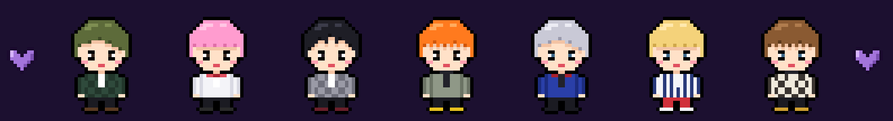

# Borahae 💜 — un equipo pixel art para Claude Code

Siete chibis pixel art (Joonie, WWH, Meowmeow, Hobi, Mochi, Taetae y Kookie) que trabajan como agentes de Claude Code. Cada uno puede tener cualquiera de los siete roles. Un panel morado lo muestra todo: arriba, el escenario, donde los que trabajan bailan y cantan; abajo, el camerino, una habitación pixel art donde los demás duermen con su nombre encima, estilo arcade.



## Instalación

En una sesión de Claude Code en la terminal:

```
/plugin install borahae --marketplace Janis-not/Borahae_
```

Responde `y` para agregar el marketplace y elige un alcance. Desde una consola:

```
claude plugin install borahae --marketplace Janis-not/Borahae_
```

## Qué hace

- **Siete agentes** (`borahae:joonie`, `borahae:wwh`, `borahae:meowmeow`, `borahae:hobi`, `borahae:mochi`, `borahae:taetae`, `borahae:kookie`). Pídele a Claude, por ejemplo, *"que Kookie revise este archivo"*.
- **Roles intercambiables:** Documentador e Investigador, Innovación y Lluvia de Ideas, Desarrollador, Auditor y QA, Analista UX y Diseñador Web, Analista de Negocio, DBA y DevOps. Cada rol trae sus instrucciones y sus herramientas; por ejemplo, QA solo lee y ejecuta tests.
- **Un PM que pone orden:** Joonie es el Project Manager (y sigue con su rol). Divide los encargos grandes en tareas, las reparte según el rol de cada miembro y te pregunta las decisiones (`❓ DECISIÓN: …`) antes de avisar al equipo.
- **Trabajo en equipo:** un miembro puede pedirle algo a otro (`🔀 DELEGAR → borahae:<id>: …`) y la sesión principal se lo pasa. Si el encargo es complejo o delicado (`🔀 CONSULTAR → …`), primero te pregunta a ti.
- **Registro de tareas:** cada encargo de un miembro queda anotado, en curso o terminado, junto con la lista `📋 TAREAS:` con la que cierra su informe. Lo ves con `/borahae-tareas` o en `~/.claude/borahae-memoria/tareas.md`. El equipo comparte un cuaderno de memoria en `~/.claude/borahae-memoria/`.
- **Panel en dos mitades:**
  - **Escenario (arriba):** un concierto pixel art en un estadio de noche, con gradas llenas de lightsticks, un aro de focos, pantallas LED con el equipo, un gran corazón en el centro y fuentes de chispas. Quien trabaja baila y canta en la tarima (🎤 CANTANDO, notas ♪ ♫), y debajo se ve el tiempo que lleva y su tarea. Si nadie trabaja, el escenario sigue ahí, vacío y con las luces bajas.
  - **Camerino (abajo):** una habitación pixel art con estrellas que titilan; quien descansa duerme ahí con una placa de nombre. Morada: descansando; verde: terminó; roja: error. El camerino siempre se ve: si el panel es bajo, la imagen se encoge.
- **Detalles morados:** el spinner, la línea de fin de turno ("💜 Hecho con amor") y una franja sobre el prompt cuando alguien trabaja.
- **Tokens para herdr:** escribe tu uso del plan en `~/.claude/borahae-usage.json`, que lee la tarjeta de tokens del layout Borahae de herdr.

## Comandos

| Comando | Qué hace |
|---|---|
| `/borahae` | Abre el panel y muestra al equipo |
| `/borahae-rol <miembro> <rol>` | Cambia el rol de un miembro (`docs`, `ideas`, `dev`, `qa`, `ux`, `negocio`, `devops`). Con `pm`, lo nombra Project Manager sin quitarle su rol. Sin argumentos, lista el equipo |
| `/borahae-tareas [miembro]` | Lista las tareas en curso y terminadas de cada miembro, con lo que hizo y lo que dejó pendiente |
| `/borahae-tokens` | Muestra tus límites del plan y cuánto falta para que se restablezcan |

Los roles se recuerdan entre sesiones.

## Requisitos

- El panel se abre solo al empezar la sesión si la terminal tiene unas 144 columnas o más. Si es más estrecha, ábrelo con `/borahae`.
- Las imágenes se dibujan con gráficos de terminal (protocolo de kitty o Ghostty, por ejemplo en herdr). En otras superficies se ven los nombres en su lugar.
- Los límites del plan solo existen con una suscripción de Claude.

## Qué guarda y qué lee

- Guarda tu elección de roles en el almacenamiento del plugin.
- Escribe `~/.claude/borahae-usage.json` con tus porcentajes de uso, la hora de reinicio, el contexto y el costo de la sesión.
- Los agentes leen y escriben su cuaderno en `~/.claude/borahae-memoria/`.
- Guarda el registro de tareas en el almacén del plugin (las últimas 300) y lo copia en `~/.claude/borahae-memoria/tareas.md`.
- No hace peticiones de red.

## Licencia

MIT. Los personajes, el camerino y el corazón son dibujos originales.
